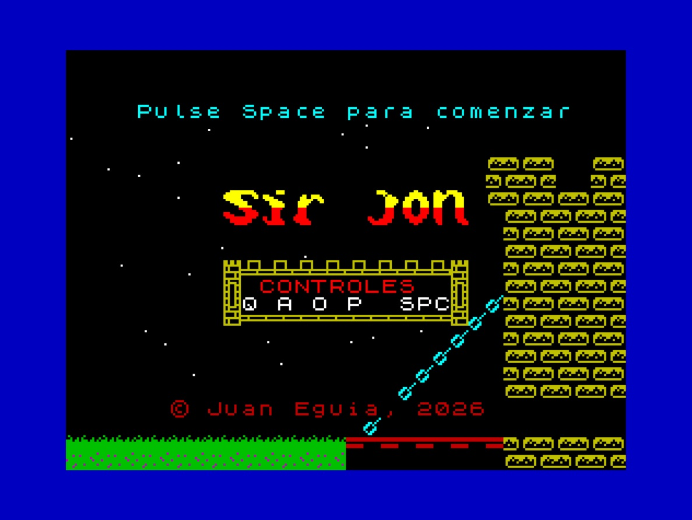
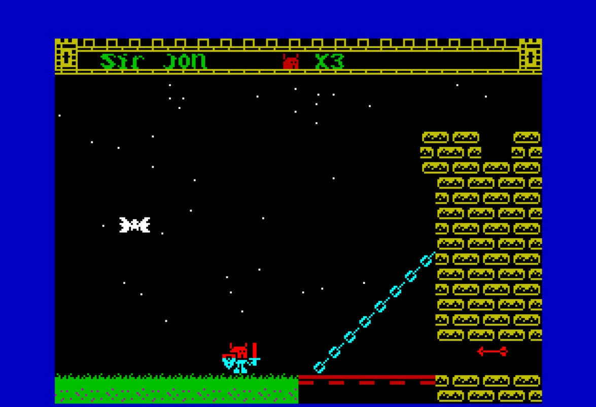
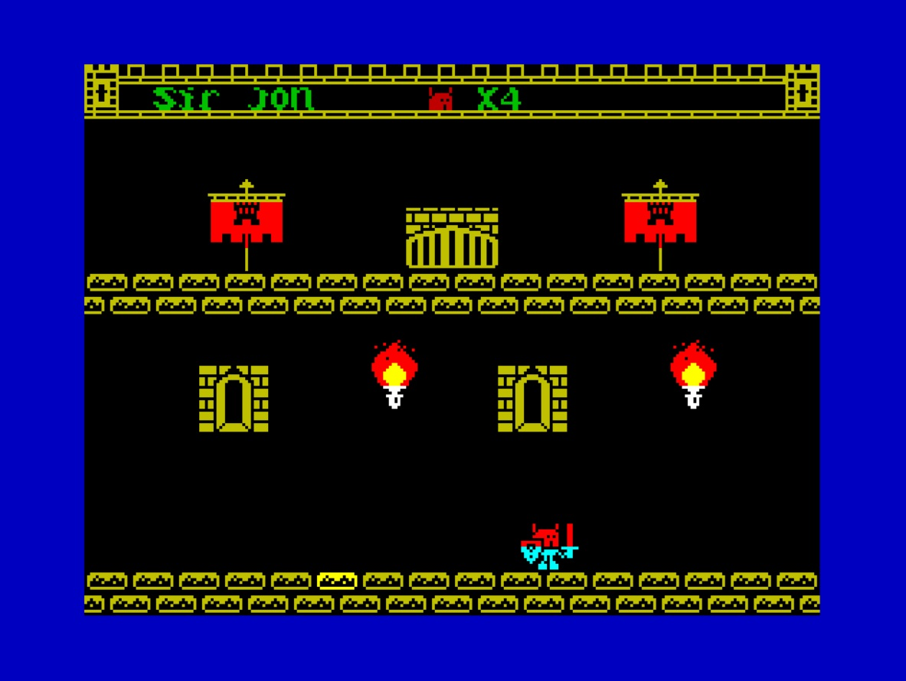
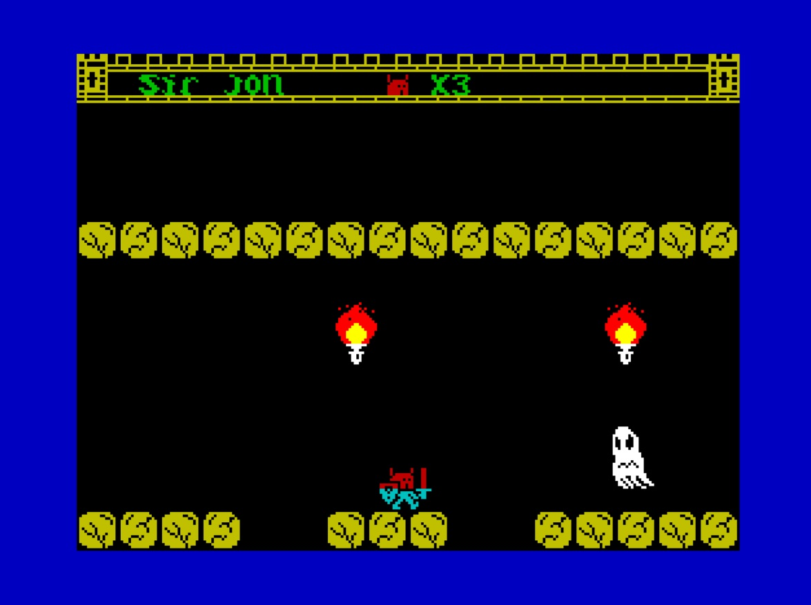
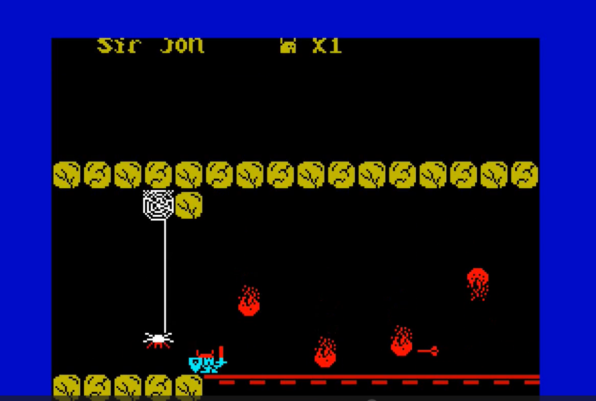
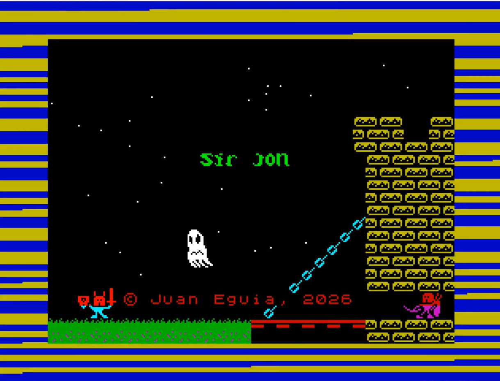

# ***Sir Jon v 2.0*** — juego para ZX Spectrum 48K

### Programado íntegramente en ensamblador Z80 por Juan Eguía



**Sir Jon** es un juego de plataformas y aventura para el **ZX Spectrum 48K**. Eres un caballero medieval que tiene que atravesar un castillo lleno de trampas y criaturas: fantasmas, una araña, un murciélago, un arquero, gotas de agua, bolas de fuego, pinchos y flechas ocultas. Para llegar al final hay que encontrar la llave, cruzar las puertas y sobrevivir a las 22 pantallas del castillo.

Este repositorio contiene la **versión 2** del juego: el código original revisado y limpiado, con mejoras gráficas, sonoras y de jugabilidad (entre ellas, el **salto** y dos **pantallas nuevas de plataformas**).

---

## Índice

- [Cómo jugar](#cómo-jugar)
- [Controles](#controles)
- [El juego](#el-juego)
- [Novedades de la versión 2](#novedades-de-la-versión-2)
- [Capturas](#capturas)
- [Compilar el código](#compilar-el-código)
- [Estructura del proyecto](#estructura-del-proyecto)
- [Detalles técnicos](#detalles-técnicos)
- [Historia del proyecto](#historia-del-proyecto)
- [Autor y licencia](#autor-y-licencia)

---

## Cómo jugar

El juego se distribuye como fichero de cinta **`.tap`**, listo para cargar en cualquier emulador de ZX Spectrum o en una máquina real (con un cargador de `.tap` como DivMMC):

| Fichero | Versión |
|---|---|
| [`tap/sjv2_0.tap`](tap/sjv2_0.tap) | **v2.0** (la actual: salto, pantallas de plataformas…) |
| [`tap/sjv1_5.tap`](tap/sjv1_5.tap) | v1.5 (la versión 1 revisada, sin salto) |

1. Abre el `.tap` con un emulador, por ejemplo **Fuse**, **ZEsarUX**, **Spectaculator**, **Retro Virtual Machine** o uno online como **JSSpeccy** / **Qaop**.
2. Elige un **ZX Spectrum 48K** y carga la cinta (`LOAD ""`; casi todos los emuladores lo hacen solos al abrir el fichero).
3. Tras la pantalla de carga aparece el título con su música: pulsa **ESPACIO** para empezar.

---

## Controles

| Tecla | Acción |
|---|---|
| **O** | Izquierda |
| **P** | Derecha |
| **Q** | Saltar (con **O** / **P** a la vez: salto hacia ese lado) |
| **A** | Agacharse |
| **ESPACIO** | Golpe de espada (un golpe por pulsación) |

---

## El juego

- **Objetivo:** recorrer el castillo de pantalla en pantalla hasta la puerta final. Algunas puertas solo se abren con la **llave**: si te falta, un indicador te recuerda que tienes que volver a por ella. Cuando la coges, vuela hasta el marcador con un sonido.

- **Vidas:** empiezas con 4. Las pierdes al tocar a un enemigo o una trampa, o al caer por un hueco del suelo. Tras perder una, el caballero parpadea un rato y es invulnerable.

- **Vidas extra (1UP):** matar al murciélago con la espada da una vida extra.

- **Enemigos y trampas:**
  - **Fantasmas** que cruzan la pantalla por ambos lados: se matan con la espada, mirando hacia ellos.
  - **Araña** que baja colgada de su hilo: también se puede matar.
  - **Murciélago** que entra en picado.
  - **Arquero** que dispara flechas (lentas o rápidas según la pantalla).
  - **Flechas trampa**, **gotas** que caen del techo, **bolas de fuego**, **pinchos** que salen del suelo y **bloques trampa**.
- **El salto** sirve sobre todo para **esquivar**: en lo alto del salto las flechas y los proyectiles no te alcanzan. Las flechas rápidas se esquivan saltando en el sitio y las lentas saltando hacia ellas con **Q** + **P**.

- **Pantallas de plataformas:** entre la pantalla 10 y la 11 hay dos pantallas con huecos en el suelo que hay que salvar saltando, mientras dos fantasmas te atacan desde ambos lados.

---

## Novedades de la versión 2

**Jugabilidad**
- **Salto** con la tecla Q, en el sitio o hacia delante o atrás, con su propia curva y la posibilidad de esquivar flechas y proyectiles.
- **Dos pantallas nuevas de plataformas** con huecos en el suelo, caída animada y dos fantasmas.
- **Espada:** ahora es un golpe por pulsación (antes, manteniendo ESPACIO, atacaba sin parar).
- Se puede matar a la **araña** en todas las pantallas.
- **Arreglados varios bugs menores**

**Gráficos**
- **Marcador** dentro de un recuadro medieval (muralla con almenas y torres).
- **Título** a doble tamaño con degradado y un recuadro con los controles.
- **Decoración** nueva en varias pantallas: estandartes, etc.
- **Animación** de la llave volando hasta el marcador.

**Sonido**
- **Música** en el título (se corta con ESPACIO).
- **Sonido** al **coger** la **llave** y al abrir las puertas que la necesitan y en el **game over**.

---

## Capturas

| | |
|---|---|
|  |  |
| *Pantalla 0: el exterior del castillo* | *Dentro del castillo* |
|  |  |
| *Pantalla de plataformas (v2)* | *Bolas de fuego (versión 1)* |



*Pantalla de carga*

---

## Compilar el código

El juego se ensambla con **[Pasmo](https://pasmo.speccy.org/)** (ensamblador cruzado de Z80).

### Solo el juego

```
pasmo --tap main.asm sirjon.tap
```

`main.asm` incluye el resto de módulos. El resultado es un `.tap` con el bloque de código, que empieza en la dirección `$8000` (32768).

### El `.tap` completo (cargador + pantalla de carga + juego)

En Windows, **`compilar.bat`** hace los tres pasos:

1. Compila `main.asm`.
2. Compila `caratula.asm` (la pantalla de carga, que incluye `caratsj.bin`).
3. Une el cargador BASIC, la pantalla y el juego en un único `.tap`.

> `compilar.bat` espera encontrar `pasmo.exe` en el PATH o en la carpeta del proyecto, y el cargador BASIC ya en cinta en `tap\taps\loader.tap`.

---

## Estructura del proyecto

| Fichero | Contenido |
|---|---|
| `main.asm` | Punto de entrada: inicio, pantalla de título, bucle principal y la lista de módulos incluidos |
| `const.asm` / `var.asm` | Constantes (posiciones, colores, vidas iniciales…) y variables del juego |
| `jugador.asm` | Dibujado del caballero (con su fondo), atributos, explosión y salto |
| `teclado.asm` | Lectura del teclado: movimiento, salto, espada, trucos, caída por los huecos |
| `jugabilidad.asm` | Lógica de cada pantalla: qué enemigos salen, cuándo y por dónde se sale |
| `pantallas.asm` | Motor de pantallas por **piezas** (suelos, ventanas, antorchas, gráficos, huecos…) |
| `pantallas-datos.asm` | La descripción de las 22 pantallas como listas de piezas |
| `pantalla0.asm` | La pantalla exterior del castillo (dibujada con código propio) |
| `fantasmas.asm`, `arana.asm`, `murcielago.asm`, `arquero.asm`, `flecha-arquero.asm`, `flecha-trampa.asm`, `gotas.asm`, `bolas-fuego.asm`, `pinchos.asm`, `anima-bloquetrampa.asm` | Un módulo por enemigo o trampa |
| `llave-indicador.asm` | La llave: recogerla, el vuelo al marcador, el indicador y el inventario |
| `hud-marco.asm` | El recuadro medieval del marcador |
| `musica.asm` / `audio.asm` | Melodías (título, llave, game over) y efectos de sonido, con el beeper de la ROM |
| `show1up.asm`, `gameover.asm`, `jugador-completed.asm` | Vida extra, game over y final del juego |
| `rutaux.asm`, `dibuj-aux.asm`, `attr-aux.asm` | Rutinas auxiliares: pantalla, marcador, vidas, cambios de pantalla, textos… |
| `sprites.asm` | Todos los gráficos (sprites, tipografías, decoración) |
| `caratula.asm` + `caratsj.bin` | Pantalla de carga |
| `compilar.bat` | Script de compilación |
| `tap/` | Versiones compiladas listas para jugar |
| `screenshots/` | Capturas para este README |
| `old_versions/` | Versiones antiguas |

---

## Detalles técnicos

- **Máquina:** ZX Spectrum 48K, Z80 a 3,5 MHz. El código está en `$8000` y ocupa unos 22,8 KB.

- **Gráficos:** sprites prerrotados (desplazados de 2 en 2 píxeles) y dibujados con OR sobre el fondo guardado, para que el caballero no borre el escenario que tiene detrás.

- **Pantallas como datos:** cada pantalla es una lista de "piezas" (`P_SUELO`, `P_VENTANA`, `P_GRAFICO`, `P_HUECO`, `P_RECT`…) que interpreta `dibuja_lista`. Añadir o decorar una pantalla consiste en escribir datos, sin código nuevo.

- **Salto:** es un desplazamiento visual (`salto_altura`) sobre la posición del caballero en el suelo, que sigue una tabla de alturas. Mientras está alto, las colisiones con los objetos se ignoran.

- **Sonido:** con la rutina BEEPER de la ROM (`$03B5`). Las melodías son tablas de notas que lee un pequeño reproductor (`musica.asm`).

---

## Historia del proyecto

- **v1:** el juego original, escrito cuando aprendía ensamblador Z80.
- **v1.5:** revisión completa del código y corrección de errores, además de mejoras gráficas y sonoras.
- **v2.0:** salto, pantallas de plataformas, espada por pulsación y más pulido general.

---

## Autor y licencia

- **Juan Eguía** — [github.com/juan1639](https://github.com/juan1639)

- Gráficos creados con SevenuP (© Jaime Tejedor Gómez, "Metalbrain")

Distribuido bajo la **licencia MIT**: consulta el fichero [LICENSE](LICENSE).
